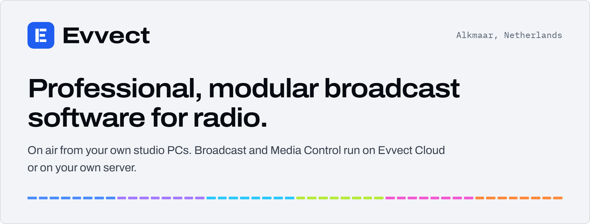
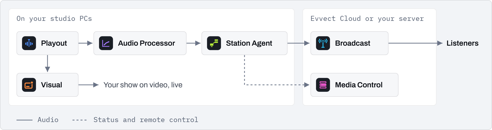

<picture>
  <source media="(prefers-color-scheme: dark)" srcset="https://raw.githubusercontent.com/evvectmedia/.github/main/profile/assets/banner-dark.png">
  
</picture>

 

Evvect Media builds the software a radio station runs on: playout, sound processing, streaming and one place to watch over every studio. Each module works on its own, and they are made to work together, so a station can start with one and add the rest.

Everything that makes the sound runs on your own studio PCs. Broadcast, the server your listeners reach, and Media Control run on Evvect Cloud or on your own server. You choose per module.

### The modules

<table>
  <thead>
    <tr>
      <th></th>
      <th align="left">Module</th>
      <th align="left">Runs on</th>
    </tr>
  </thead>
  <tbody>
    <tr>
      <td></td>
      <td><b>Evvect Playout</b> Plays the station, hour by hour.</td>
      <td>Your studio PCs</td>
    </tr>
    <tr>
      <td></td>
      <td><b>Evvect Audio Processor</b> The loudness and sound of every stream.</td>
      <td>Your studio PCs</td>
    </tr>
    <tr>
      <td></td>
      <td><b>Evvect Broadcast</b> The streaming server your listeners reach.</td>
      <td>Evvect Cloud or your own server</td>
    </tr>
    <tr>
      <td></td>
      <td><b>Station Agent</b> Links each studio PC to your server.</td>
      <td>Your studio PCs</td>
    </tr>
    <tr>
      <td></td>
      <td><b>Evvect Media Control</b> Every station and PC on one screen.</td>
      <td>Evvect Cloud or your own server</td>
    </tr>
    <tr>
      <td></td>
      <td><b>Evvect Visual</b> Puts your show on video, live.</td>
      <td>Your studio PCs</td>
    </tr>
  </tbody>
</table>

### How they fit together

<picture>
  <source media="(prefers-color-scheme: dark)" srcset="https://raw.githubusercontent.com/evvectmedia/.github/main/profile/assets/chain-dark.png">
  
</picture>

Playout feeds the Audio Processor on the same PC. Station Agent carries the finished sound to Broadcast and reports each PC's status to Media Control.

### Book a demo

We share our screen and take you through a live hour on air. Bring your log and your questions.

<!-- Placeholder: put the demo contact address here once the Evvect mailboxes are set up. -->
**Contact:** the demo address follows at launch.

 

EVVECT V.O.F., Alkmaar, Netherlands. Evvect Media is a trade name of EVVECT V.O.F.
